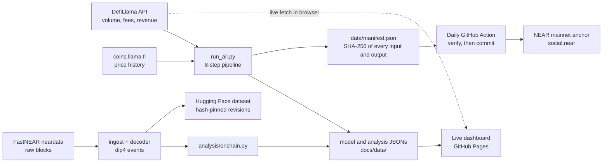

# NEAR Intents Investment Thesis

**At today's volume, NEAR Intents buybacks cover 19.7% of NEAR's token issuance. Reaching break-even needs 3.3x volume growth, or a fee switch enforced by the contract. The settlement contract charges 0.01 bps per fill; the roughly 5 bps that actually funds buybacks is set off-chain, and its 30-day average has swung between 1.9 and 6.0 bps over the last four months.**

| | |
|---|---|
| Offset ratio today | **19.7%** of daily issuance |
| Break-even volume | **$409M/day** at the HSP-029 floor, 3.3x current |
| Measured contract fee | **0.01 bps** per fill side, from 51,779 measured fill sides |
| Days revenue ever covered issuance | **6 of 567** priced days |

[Live dashboard](https://bomanaps.github.io/-near-intents-thesis/dashboard.html) · [Thesis memo](https://bomanaps.github.io/-near-intents-thesis/thesis-memo.html) · [THESIS.md](THESIS.md) · [Frozen predictions](PREDICTIONS.md) · [Claims and proofs](docs/claims.md) · [For AI reviewers](CLAUDE.md)

Built for the NEAR Hackathon 2026, Investment Thesis track. Figures below are as of November 13, 2026 with data through November 12; the dashboard fetches current data on every page load.

## Key Findings

| Metric | Value |
|---|---|
| Current daily volume (30d avg) | $125.8M |
| Current offset ratio | 19.7% |
| Break-even at 2.5% issuance cap | $639M / day |
| Break-even at 1.6% cap (HSP-029 floor) | $409M / day |
| Capture rate (30d trailing) | 5.03 bps (30d average has ranged 1.9 to 6.0 bps since July) |
| HSP-029 vote passed | Nov 2, 2026 (ramp pending ratification) |
| Days revenue covered full issuance | 6 of 567 priced days (1.1%) |

HSP-029 cuts the issuance cap from 2.5% to 1.6% over 24 months. The Nov 2 vote is not activation: per the proposal, the ramp starts one full quarter after ratification and validator adoption makes it binding, so the base case assumed here is an April 2027 start, putting the 30.8% flat-volume offset ceiling around April 2029. Break-even still requires 3.3x volume growth at the 1.6% floor. The dashboard exposes the ramp start date as an explicit assumption.

## What It Measures

**Break-even formula:**

```
B = V * r / P        # daily NEAR bought back
I = S * cap / 365    # daily NEAR issued
Offset = B / I       # fraction of issuance covered
Break-even volume = I * P / r
```

Where `V` = daily volume (USD), `r` = capture rate, `P` = NEAR price, `S` = total supply, `cap` = annual issuance cap.

## Quantitative Models

**Volume forecast** (`model/forecast.py`): 10,000 simulations over a 3-year horizon. Break-even is defined as a sustained crossing (the 30-day average volume reaching the threshold, not a one-day spike), and thresholds are recomputed at every run from the live NEAR price and current capture rate. Methods: random walk with drift on the log 30-day average (365d and 180d calibration windows, residual bootstrap) plus a 30-day block bootstrap of daily returns as a non-parametric check. An earlier GBM version was tested and rejected (double-counted Ito correction, absurd one-year dispersion), as was an unconstrained AR(1) (fitted phi near 1 makes its stationary level an unstable extrapolation); the rejection rationale ships inside the model output. The 12-month sustained-crossing probability for the 1.6%-cap threshold spans a wide range across methods, from the conservative 365-day trend at the low end to the full-history bootstrap (an upper bound) at the high end, because the windows disagree about whether the recent growth regime holds. The range is the answer, not any single number; it regenerates daily, and the dashboard always shows the current values.

**On-chain evidence** (`analysis/onchain.py`): decodes raw dip4 settlement events from intents.near and measures what aggregates cannot. Across 20,308 decoded settlements the explicit contract fee is 0.01 bps per fill side, measured over 51,779 fill sides, against the 5.03 bps revenue rate implied by DefiLlama; the capture rate is therefore policy rather than protocol. The top three solver accounts fill roughly two thirds of settled volume. It also measures a confidential settlement path, which received 57%, 63% and 71% of stablecoin value across the three chain days fully covered so far, counted once per settlement on both sides; that account pays out almost exactly what it takes in, so this measures where activity is routed rather than value captured, but either way a large share of settlement is leaving the public event stream. Every figure is recomputed as ingestion extends.

**Buyback price-effect regression** (`analysis/price_link.py`): weekly NEAR returns on lagged buyback intensity with BTC/ETH market controls, Newey-West errors, and a 1,000-permutation null. Result, pre-registered as likely and published as found: no detectable price effect (t = 0.59, permutation p = 0.67, 38 weeks). The strong contemporaneous correlation (t = 3.5) vanishes under the lag, the signature of reverse causality. The thesis rests on the issuance-offset mechanism, not a price effect.

**Fee-switch difference-in-differences** (`model/fee_switch.py`): DiD analysis of the Feb 23, 2026 protocol fee switch using 1inch, Paraswap, and Jupiter as controls. The raw estimate is 1.11x (bootstrap CI 0.97 to 1.25), but this analysis does not treat that as evidence the fee was harmless, and the model output says so. NEAR's own volume fell 19% after the switch; the raw figure is positive only because the controls fell further. NEAR was also trending up beforehand (+195%/yr) while the controls trended down (-52%/yr), and carrying that differential across the window gap turns the estimate into 0.71x, a 29% relative decline. Measuring uncertainty across the three controls rather than across days widens the interval to 0.86 to 1.42, and with four units the permutation test cannot return a p-value below 0.25. The honest reading is that the fee switch's volume effect is not identified by this design.

## Data Sources

| Source | Coverage | Status |
|---|---|---|
| DefiLlama API (volume, fees, revenue) | daily since Dec 2024, refreshed daily by the Action | Complete |
| FastNEAR neardata (on-chain events) | intents.near, shard 7, dip4 standard. [Download dataset](https://huggingface.co/datasets/bomankari/near-intents-onchain-events) | Ingesting |
| NEAR RPC (supply, block metadata) | rpc.mainnet.near.org | Complete |

On-chain ingestion is ongoing. DefiLlama data is the primary source for all models. FastNEAR data will provide solver concentration (HHI) and token-pair breakdown once ingestion completes.

## How It Fits Together



Each run rebuilds every number from raw data, hashes the results, and the daily Action refuses to commit unless the hashes verify; the manifest hash is then anchored on NEAR mainnet.

## How to Run

```bash
pip install pandas pyarrow numpy scipy
python3 run_all.py              # fetch fresh data, run models and analyses, publish JSONs, write the manifest
python3 run_all.py --no-fetch   # same, but use the committed data instead of fetching
```

`py-near` is needed only for the optional on-chain anchoring step (`analysis/anchor.py`), which the GitHub Action runs with repository secrets.

Each model can also run standalone: `python model/forecast.py` or `python model/fee_switch.py`.

The dashboard fetches live DefiLlama data in the browser on every page load (volume, revenue, NEAR price) and reads model outputs from `docs/data/*.json`. If the live fetch fails it falls back to the embedded snapshot and says so in the header badge.

Open `docs/index.html` locally or visit the live site linked above.

## Run the Tests

```bash
pip install pytest
pytest tests/                   # 167 tests: models, analyses, decoder, manifest
RUN_SLOW=1 pytest tests/test_run_all_smoke.py   # full pipeline smoke test
```

## Files

```
run_all.py            one-command pipeline: fetch, model, analyze, publish, manifest

.github/workflows/
  refresh-data.yml    daily refresh: pipeline, integrity verify, on-chain anchor, commit

docs/
  index.html          landing page
  dashboard.html      interactive break-even explorer
  thesis-memo.html    written investment thesis
  data/               model and analysis JSONs served by GitHub Pages

model/
  forecast.py         sustained-crossing volume forecast
  fee_switch.py       difference-in-differences analysis
  issuance.py         break-even math, Decimal precision
  scenarios.py        scenario matrix

analysis/
  onchain.py          on-chain evidence from decoded dip4 events
  frequency.py        days revenue covered issuance, from price-joined history
  price_link.py       buyback price-effect regression with market controls
  manifest.py         data integrity manifest: write and verify
  anchor.py           posts the manifest hash to NEAR mainnet (social.near)

ingest/
  fastnear_ingest.py  FastNEAR on-chain event ingestion
  watchdog.sh         process monitor, uploads snapshots to Hugging Face
  hf_upload.py        hashed, revision-pinned dataset upload

decoder/              typed dip4 and NEP-297 event decoder

tests/                167 tests across models, analyses, decoder, manifest

data/
  manifest.json       SHA-256 of every input and output
  raw/
    daily_metrics.parquet   full DefiLlama daily history
  model/
    forecast.json           forecast output
    fee_switch.json         DiD output
    onchain.json            on-chain evidence output
    frequency.json          revenue-coverage output
```

## Data Integrity

Every number traces to a hashed input. `data/manifest.json` records the SHA-256 and size of every raw input and model output, written as the final step of every pipeline run. The raw on-chain events are pinned differently because the file grows continuously: each Hugging Face upload hashes the exact bytes it ships and records the HF commit id, so any snapshot can be re-downloaded at that revision and checked against its digest. The daily GitHub Action verifies all hashes before it is allowed to commit.

```bash
python3 analysis/manifest.py verify
```

Every headline claim is mapped to the code that computes it, the test that guards it, and an independent check in [docs/claims.md](docs/claims.md).

Five dated, falsifiable predictions are frozen in [PREDICTIONS.md](PREDICTIONS.md), with the file's SHA-256 anchored on NEAR mainnet before any resolution window opened: [transaction BNrTV6ug...](https://nearblocks.io/txns/BNrTV6ugGqcnfv83U1osUXuommLPkksac9DaKE6huXf) under `bomanaps.near/thesis_predictions` on `social.near`. Misses will be reported as misses.

The manifest hash is also anchored on NEAR mainnet: after each verified daily refresh, the Action posts the manifest's SHA-256 to NEAR Social DB under `bomanaps.near/thesis_manifest` (contract `social.near`). The current record is readable on [near.social](https://near.social) or via RPC, and every historical anchor is permanent in the [account's transaction history](https://nearblocks.io/address/bomanaps.near). If the repo's data history were ever rewritten, the on-chain hashes would expose it.

## How This Entry Differs

The dashboard fetches live DefiLlama data in the browser on every load: current price, volume, and capture rate, with every panel recomputing instantly and an honest snapshot fallback when offline. Beyond that, this entry is distinguished by what it measured rather than assumed: an open dataset of raw decoded dip4 settlement events ([Hugging Face](https://huggingface.co/datasets/bomankari/near-intents-onchain-events)), the finding that the settlement contract collects 0.01 bps while the effective capture is 5.02 bps and drifting (capture is policy, not protocol), measured solver concentration (top three solvers fill roughly two thirds of settled volume in the decoded window), the confidential settlement path measured at 62% to 78% of stablecoin value and rising, a causal fee-switch counterfactual (DiD vs three controls), and the exact count of days revenue ever covered issuance (6 of 567). The fee-switch argument requires both the on-chain fee measurement and the causal counterfactual; this entry has both.

## Track

NEAR Hackathon 2026, Investment Thesis
Deadline: November 14, 2026
